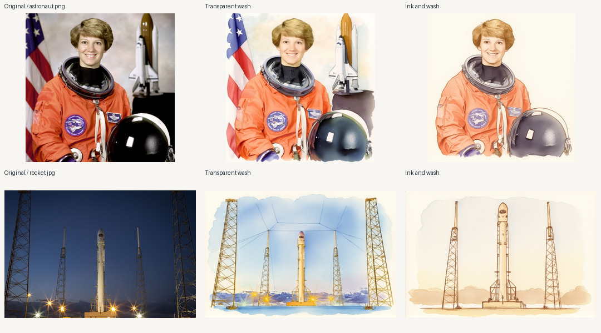

# Kontext Watercolor Studio

Turn a photograph into a watercolor painting in ComfyUI while keeping the subject and composition. The studio includes the original single-photo workflow, a quantized workflow for an 8 GB GPU, and a local client for uploading photographs, rendering them and rebuilding comparison sheets.



## What the two instructions changed

The transparent wash retained the astronaut's orange suit, helmet, flag and shuttle model. The ink-and-wash instruction kept the portrait but replaced the flag and shuttle with blank paper. In the launch-pad scene the transparent wash retained the four towers and lights, while the ink sketch retained only the inner pair of towers. Both treatments brightened the night sky. These are observable changes in two photographs. Source conditioning does not guarantee preservation of every object, inscription or lighting condition.

The four genuine renders ran on an NVIDIA GeForce RTX 4060 Laptop GPU with 8 GB VRAM. All used seed 42, 20 Euler/simple steps, guidance 2.5 and a 0.5-megapixel reference canvas. The astronaut outputs are 720 × 720 and the rocket outputs are 880 × 584. Queue submission through receipt of the output PNG took 120.0 to 142.0 seconds per request, including first-use model loading where applicable. Photo normalization and input upload precede this measurement. Model or preprocessing nodes could be reused after the first request; the sampler ran in each case. [Per-image timings and hashes](results/summary.csv) · [Run manifest](results/manifest.json)

An independent GitHub clone reran all four cases on a new server with empty execution caches. All four PNGs matched the archive byte for byte, every RGB channel matched, and the rebuilt comparison sheet was identical on the tested machine. [Independent reproduction record](results/clean-clone-verification.json)

## Start with the original workflow

Drag [the original FP8 workflow](workflows/original-fp8.json) onto a ComfyUI canvas with FLUX.1 Kontext [dev] support. Upload a photo in the image node. The original practice uses 13 built-in nodes, seed 42, 20 Euler steps and guidance 2.5. The author previously confirmed running this exercise. Its original source photo and generated PNG were not preserved. [Original-workflow model setup](https://docs.comfy.org/tutorials/flux/flux-1-kontext-dev)

## Run the smaller workflow locally

Use Python 3.11, Git and a CUDA-enabled PyTorch environment. Run these from the root of this repository. Put the server and all four weights outside this checkout.

```powershell
python -m venv .venv
.\.venv\Scripts\Activate.ps1
python -m pip install torch==2.4.1 torchvision==0.19.1 torchaudio==2.4.1 --index-url https://download.pytorch.org/whl/cu121
git clone --depth 1 --branch v0.3.50 https://github.com/Comfy-Org/ComfyUI.git ../ComfyUI-Kontext
git -C ../ComfyUI-Kontext checkout --detach d5c1954d5cd4a789bbf84d2b75a955a5a3f93de8
git clone https://github.com/city96/ComfyUI-GGUF.git ../ComfyUI-Kontext/custom_nodes/ComfyUI-GGUF
git -C ../ComfyUI-Kontext/custom_nodes/ComfyUI-GGUF checkout --detach cf0573351ac260d629d460d97f09b09ac17d3726
python -m pip install -r ../ComfyUI-Kontext/requirements.txt -r requirements.txt -r requirements-server.txt
python scripts/fetch_models.py --models ../watercolor-models
python run.py verify-models --models ../watercolor-models
python scripts/serve.py --comfy ../ComfyUI-Kontext --models ../watercolor-models
```

The download is about 10 GB. The fetcher resumes complete byte ranges and checks the whole-file SHA-256 before exposing each model to the server. Review the source cards and model terms first. The service binds to loopback on port 8188. Keep it running and use another terminal in the same environment.

```powershell
python run.py render path/to/photo.jpg --preset transparent-wash --out work/my-painting
python run.py demo --out work/portrait
python run.py reproduce --out work/study
python run.py evaluate --out work/study
python -m unittest discover -s tests
```

For the visual editor, open the local server and drag in [the editable GGUF workflow](workflows/watercolor-ui.json). Choose a local photo in the first node and edit its instruction. The [API graph](workflows/watercolor-api.json) follows the same connections. Batch renders take their prompts and defaults from [studio.json](configs/studio.json). Use `--preset ink-and-wash` for linework, or `--prompt "…"` to provide your own instruction.

## Image path and outputs

The VAE encodes the submitted image. Its latent feeds both the sampler and the `ReferenceLatent` node on the positive conditioning path. CLIP-L and T5 encode the edit text. Each preset uses the same source, seed and step budget; only the instruction changes. The compact profile uses Q4_K_S Kontext, Q4_K_M T5 and a half-megapixel canvas in place of the original FP8 loaders and official approximately one-megapixel resize.

`render` saves the normalized source PNG, generated PNG, submitted graph and run receipt per case. A request times out after one hour by default. The receipt includes input, upload, output and graph hashes, seed, observed end-to-end latency and cached server nodes. `reproduce` runs both presets on both bundled photographs. `evaluate` reloads saved pixels, verifies the graph against the recorded instruction and seed, and rebuilds the comparison sheet offline. Each new run requires an unused output directory.

[Photo credits](examples/SOURCES.md) · [Model and code provenance](UPSTREAM.md) · [Handoff and verification status](HANDOFF.md)
